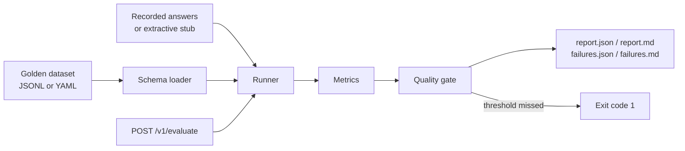

# LLM Evaluation Harness

Offline evaluation harness for retrieval-augmented answers. It scores a golden dataset with lexical metrics, runs from recorded or stubbed model output, and returns a non-zero exit code when a quality gate is missed.

Author: Alexandru Cojocari ([DatadrivenAlex](https://github.com/DatadrivenAlex)).

No API key is required. The default path never calls a model provider.

## Quick start

```bash
python3 -m venv .venv
source .venv/bin/activate
python -m pip install -e ".[dev]"
python -m pytest
python -m llm_eval run --dataset datasets/rag_faq.jsonl --out reports/
```

The sample command writes four files:

| File | What it is |
| --- | --- |
| `reports/report.md` | Pass rate, mean scores, gate, and every case |
| `reports/report.json` | The same report for CI or a dashboard |
| `reports/failures.md` | Cases that missed a case-level threshold |
| `reports/failures.json` | Those cases, including context and unsupported entities |

`datasets/rag_faq.jsonl` is an 8-case FAQ for a fictional product, Lumen Notes. The gate passes. `datasets/rag_faq.yaml` is the same set. A checked-in snapshot of that run is in [`examples/sample_report.md`](examples/sample_report.md).

```text
Dataset: datasets/rag_faq.jsonl
Cases: 8  Passed: 8  Pass rate: 100.0%
exact_match 0.875 | token_f1 0.984 | soft_overlap 0.971 | faithfulness 1.000 | hallucination_rate 0.000
Gate: PASS
```

One case is a paraphrase on purpose. `free-plan` says "comes with" where the reference says "includes", so exact match is 0, token F1 is 0.870, and the case still passes.

This command is the build breaker:

```bash
python -m llm_eval run --dataset datasets/golden_fail.jsonl --out reports/golden-fail/
echo $?   # 1
```

```text
Dataset: datasets/golden_fail.jsonl
Cases: 1  Passed: 0  Pass rate: 0.0%
exact_match 0.000 | token_f1 0.609 | soft_overlap 0.438 | faithfulness 1.000 | hallucination_rate 1.000
Gate: FAIL
Failing cases: trash-hallucination
- pass_rate 0.0000 < min_pass_rate 0.8000
- hallucination_rate 1.0000 > max_hallucination_rate 0.2000
```

The recorded answer adds `90` and `Zurich` to a 14-day trash policy. Token F1 stays at 0.609 because most of the wording is copied. Faithfulness stays at 1.000 because the metric scores whole sentences, and this sentence still clears the 60% content-token bar. The hallucination check is what fails the case. The dataset gate then fails on pass rate and on hallucination rate. The report is still written. Pytest asserts this contract, so the suite itself stays green, and CI treats the CLI status as the quality signal. The failure snapshot is [`examples/golden_fail_report.md`](examples/golden_fail_report.md).

## Architecture



The core library does not import FastAPI. `llm_eval.api` is a thin demo installed with the `api` or `dev` extra.

## How a case is scored

Each case needs a `question` and either `expected_answer` or `expected_facts`. `context` is optional and holds the retrieved chunks. `recorded_answer` is an optional offline transcript.

| Metric | Definition | Used to fail a case? |
| --- | --- | --- |
| `exact_match` | Normalized string equality with `expected_answer`. If that field is absent, every normalized fact must occur in the prediction. | Only with `--require-exact-match` |
| `token_f1` | SQuAD-style multiset F1 against the reference. Order does not matter. | Yes, below `--min-token-f1` (default 0.5) |
| `soft_overlap` | Jaccard similarity over unique tokens. | Reported only |
| `faithfulness` | Fraction of answer sentences whose content tokens are at least 60% covered by the context. Stopwords and bare numbers are ignored. | Yes, below `--min-faithfulness` (default 0.6) |
| `hallucination` | The answer contains a number, acronym, or capitalized word that is absent from the context and the question. `3` does not support `30`. | Yes, any unsupported entity fails the case |

A dataset then passes the gate when:

- pass rate is at least `--min-pass-rate` (default 0.8)
- hallucination rate is at most `--max-hallucination-rate` (default 0.2)
- the dataset is not empty

Equal to the cutoff passes. The sample FAQ passes at the defaults. Wording is allowed to vary unless you pass `--require-exact-match`.

Copy [`.env.example`](.env.example) to `.env` to change the defaults locally. The CLI reads it and does not override variables that are already exported. A CLI flag wins over `.env`.

## CLI

```bash
python -m llm_eval run \
  --dataset datasets/rag_faq.yaml \
  --responses recordings.json \
  --out reports/ \
  --min-pass-rate 0.8 \
  --min-token-f1 0.5 \
  --min-faithfulness 0.6 \
  --max-hallucination-rate 0.2
```

`--responses` is a JSON object keyed by case id or by the full question. It overrides `recorded_answer`, which is how you replay a fresh offline dump against the same golden set. `--ignore-recorded` skips transcripts and answers with the extractive stub: the context sentence with the highest token overlap to the question.

Exit codes: `0` gate passed, `1` gate failed, `2` the dataset or the thresholds could not be loaded.

There is also a console script after install: `llm-eval run --dataset ... --out reports/`.

## Optional API

```bash
python -m llm_eval serve --host 127.0.0.1 --port 8000
curl -s localhost:8000/health
curl -s localhost:8000/v1/evaluate \
  -H 'content-type: application/json' \
  -d '{"cases":[{"question":"How long is Trash?","expected_answer":"14 days","context":["Notes stay in Trash for 14 days."],"recorded_answer":"Notes stay in Trash for 14 days."}]}'
```

`POST /v1/evaluate` returns the report JSON. A failed gate stays HTTP 200 with `gate.passed: false`, so a demo client can read the body. The CLI is the failing quality gate.

Docker, still offline:

```bash
docker build -t llm-evaluation-harness .
docker run --rm -p 8000:8000 llm-evaluation-harness
docker run --rm -v "$PWD/reports:/reports" llm-evaluation-harness \
  run --dataset datasets/rag_faq.jsonl --out /reports
```

## What this maps to in hiring loops

**QA automation.** The golden file is the oracle. Thresholds are asserts. Pytest locks both the happy path and the known-bad case. GitHub Actions runs the suite, then runs the CLI and expects exit 0 on `datasets/rag_faq.jsonl` and a non-zero status on `datasets/golden_fail.jsonl`. A regression in the dataset or the scorer fails the build, and the Markdown failure export is the defect note.

**LLM evaluation.** Runs are reproducible because the model output is recorded. The report separates reference overlap (`token_f1`, exact match) from grounding (`faithfulness`, unsupported entities), so a fluent answer that invents a number does not look clean just because it shares words with the gold answer. Swap `OfflineLLM.complete` for a client with the same signature when you have a provider; the metrics and the gate stay put.

**AI training and review.** `expected_facts` is a lightweight rubric. The failures file lists the question, the answer, the context, and the unsupported entities, which is the pile you hand to someone rewriting a prompt, a chunker, or a guideline. It is an error-analysis export, not a preference-tuning pipeline.

## Honest limits

- This is not RAGAS, not a natural-language-inference model, and not a hosted LLM judge. Faithfulness is lexical overlap, scored per sentence. A sentence is supported once 60% of its content tokens appear in the context, so one unsupported name in a mostly copied sentence can leave faithfulness at 1. That is `datasets/golden_fail.jsonl`: the entity check catches it, the sentence score does not. A paraphrase that shares few tokens looks unfaithful. A sentence that copies the context and adds "not" can still look faithful, because stopwords include "not".
- The hallucination flag catches new numbers, acronyms, and capitalized words. It misses a wrong claim that reuses only words already in the context ("14 days" said about the wrong policy).
- Sentence-splitting is punctuation, not a parser. Abbreviations in the answer will be cut in the wrong place.
- Tokenization is English-oriented. It lowercases `[a-z0-9]+` runs and drops other scripts' punctuation assumptions.
- The harness does not retrieve. It scores an answer against context you already attached. There is no recall@k and no retriever.
- The stub does not estimate a live model. A green sample run means the dataset, the scorer, and the recorded answers agree. It does not mean a production model would pass.
- `$50` and `50%` match the number `50`. The marker is the value, not the unit.

## Layout

```text
src/llm_eval/     schema, metrics, stub, runner, reports, CLI, optional API
datasets/         Lumen Notes FAQ plus the failing golden case
examples/         snapshots of a passing report and the golden failure
tests/            metric, schema, gate, CLI, and API tests
.github/workflows CI on Python 3.11 and 3.12
```

`make test`, `make eval`, and `make eval-fail` wrap the same commands.

## License

[MIT](LICENSE). Copyright 2026 Alexandru Cojocari.
